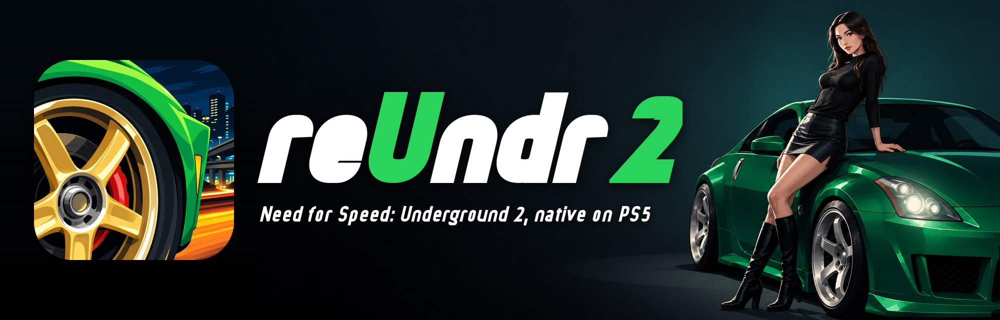
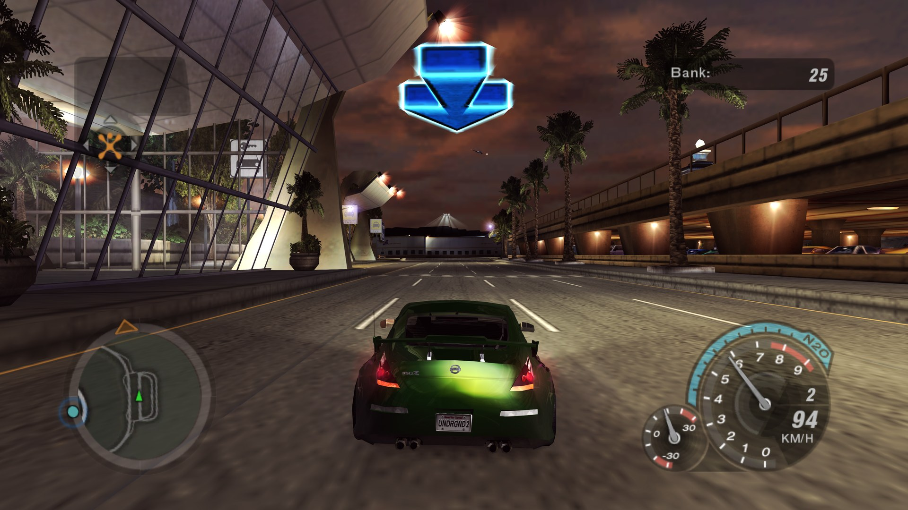
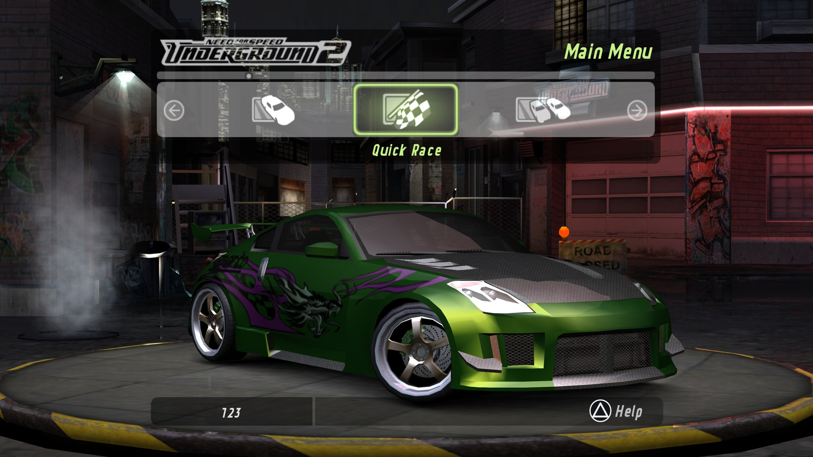
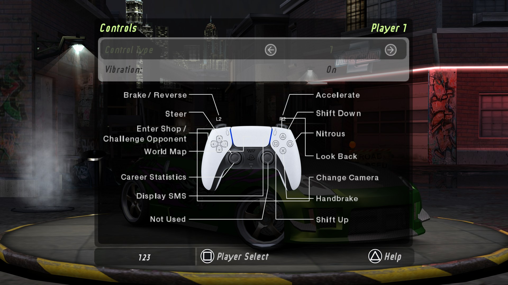
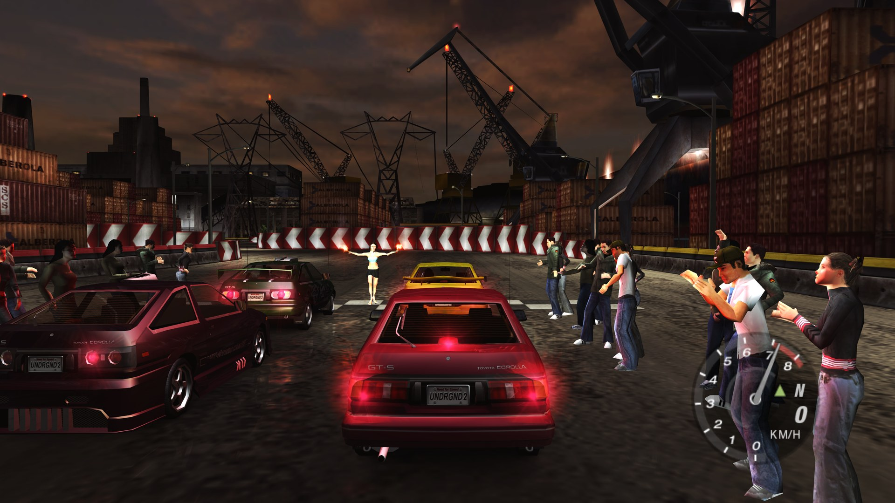
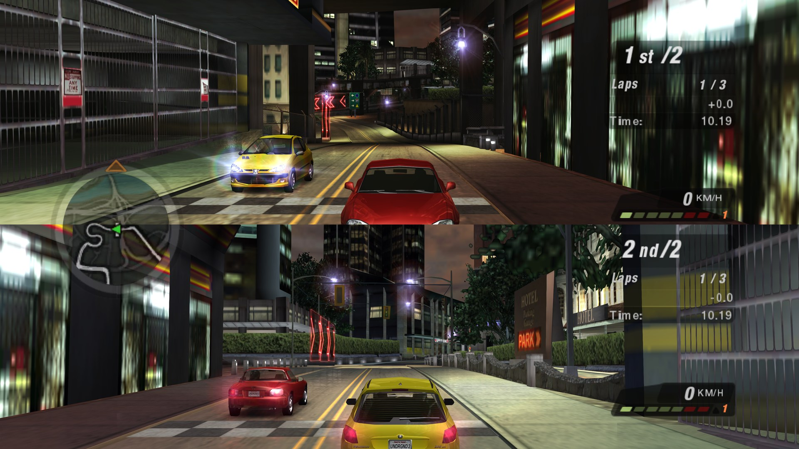
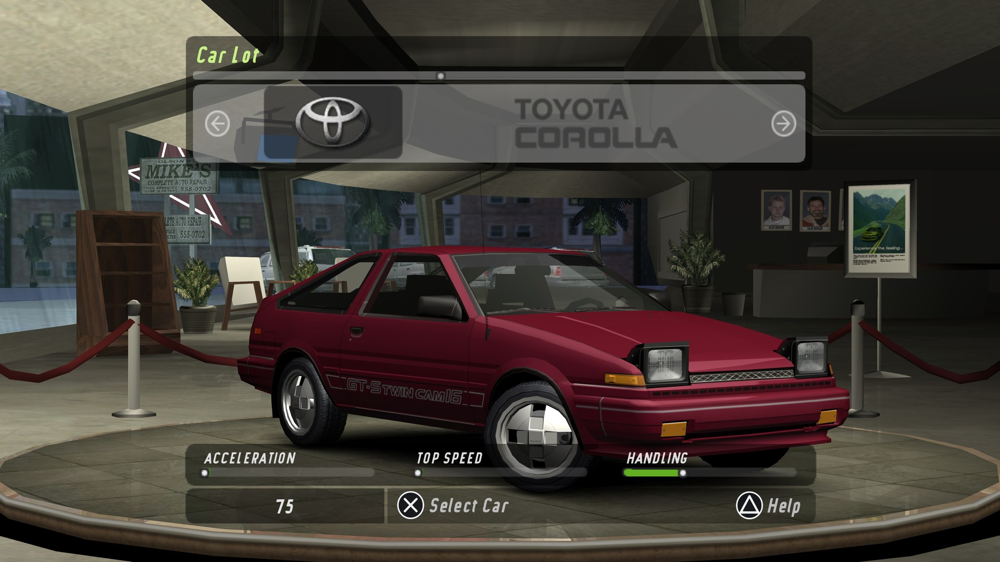
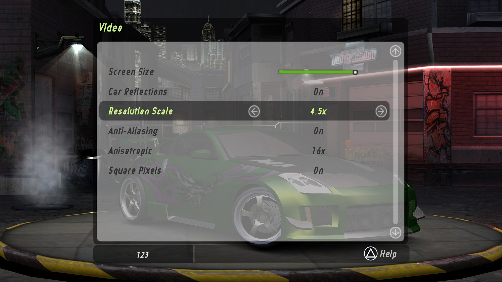
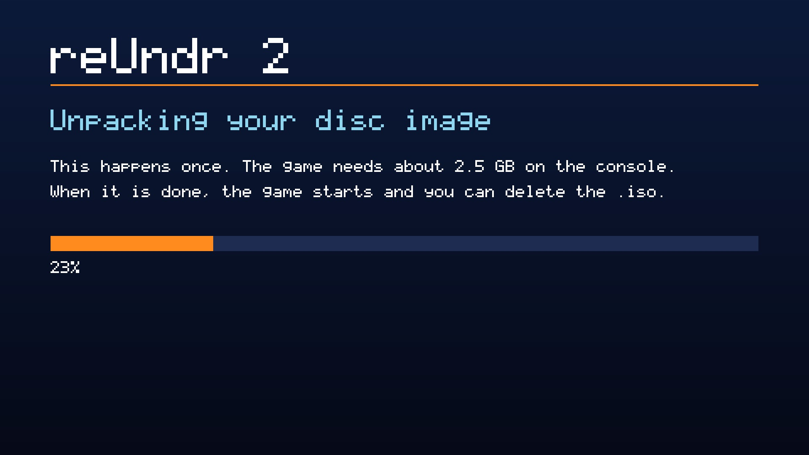

<p align="center">
  
</p>

<p align="center">
  <b>Need for Speed: Underground 2, the original Xbox version, statically recompiled<br>
  into a native app for homebrew-enabled PS5 consoles.</b>
</p>

<p align="center">
  <a href="https://prosperostore.net/app/PPSA99027/"></a>
  <a href="https://recompstore.com/game/PPSA99027"></a>
</p>

<p align="center">
  <a href="#install"><b>Install</b></a>
  &nbsp;·&nbsp;
  <a href="#controls">Controls</a>
  &nbsp;·&nbsp;
  <a href="#settings">Settings</a>
  &nbsp;·&nbsp;
  <a href="#reporting-a-bug">Report a bug</a>
</p>

> [!IMPORTANT]
> **Bring your own game.**
> This project does not include or distribute copyrighted game files. Use a dump of your own original disc.
> Please do not request or share game downloads here.

> [!CAUTION]
> **We do not support piracy.**
> Please do not use this project with pirated copies of the game.

<p align="center">
  
  <br>
  <sub>Driving through Bayview on the PS5, rendered at 3840x2160.</sub>
</p>

## What it is

The Xbox game's code is translated into C ahead of time and compiled for the PS5.
A replacement runtime handles the original console's graphics, audio, input and system services.

## Highlights

- **Native 4K.** Rendering and output at 3840x2160, up to 60 fps.
- **HD text.** The menu font is redrawn stroke by stroke with square ends, as on the disc but sharp
  at 4K (`256×256` → `2048×2048`).
- **DualSense throughout.** Cross, Circle, Square and Triangle in the prompts, PlayStation wording
  in the text and save messages, and a DualSense diagram on the controls and loading screens.
- **Two players.** Split screen on one console with two DualSense controllers and independent rumble.
- **Disc image install.** Copy your `.iso` to the console and start the app, it does the rest.
- **16:9 movies.** Cutscenes and intro videos fill the widescreen frame.

<table>
  <tr>
    <td width="50%"><br><sub>The main menu.</sub></td>
    <td width="50%"><br><sub>Controls, with this port's DualSense diagram.</sub></td>
  </tr>
  <tr>
    <td width="50%"><br><sub>The start of a race.</sub></td>
    <td width="50%"><br><sub>Two-player split screen.</sub></td>
  </tr>
  <tr>
    <td width="50%"><br><sub>The Car Lot, with PlayStation prompts.</sub></td>
    <td width="50%"> Video showing Resolution Scale 4.5x, Anti-Aliasing, Anisotropic 16x and Square Pixels"><br><sub>Options → Video.</sub></td>
  </tr>
</table>

<sub>Screenshots: reUndr 2 on a PS5, scaled to 1920x1080; otherwise unedited. The game content in
them belongs to its owners.</sub>

## Requirements

- A **PS5 that runs homebrew**, with [ShadowMountPlus](https://github.com/drakmor/ShadowMountPlus)
  and an FTP server.
- Your own **USA (NTSC-U) Xbox disc** of *Need for Speed: Underground 2*, backed up by you as a disc
  image (`.iso`) or as files. A clean dump and one with a region or media patch both work. The code
  is recompiled from this release, so a PAL or other release may not run; `stderr.log` then says
  which `default.xbe` it found.
- About **2.5 GB free** on the console.

## Install

You can also install the app from [RecompStore](https://recompstore.com/game/PPSA99027) or [ProsperoStore](https://prosperostore.net/app/PPSA99027/).
You still need to provide your own disc files as described below.

1. **The app.** Download `PPSA99027-<version>.zip` from
   [Releases](../../releases/latest), unpack it, and copy the `PPSA99027` folder to
   `/data/homebrew/` on the console. The **reUndr 2** tile appears on the home screen.
2. **Your disc.** Copy your disc image to `/data/nfsu2/` on the console, or to the top of a USB
   drive or its `nfsu2` folder. A trimmed image and a full dump both work.
3. **Play.** Start the tile. The first start unpacks the image to `/data/nfsu2/game`, and then the
   game starts. After that you can delete the `.iso`.

<p align="center"></p>

If the disc is missing, the app says so on screen and tells you where things go.

**Already have the files?** Copy them to `/data/nfsu2/game`, or to `nfsu2/game` on a USB drive
(`/mnt/usb0/nfsu2/game` to `/mnt/usb7/nfsu2/game`), so that `default.xbe` sits next to `B3` and
`NFSUNDER`.

**To update,** copy the new `PPSA99027` folder over the old one. Your saves, settings and game files
in `/data/nfsu2/` are kept.

## Controls

The game plays with its own Xbox controls, matched by position on the DualSense.

| Xbox | DualSense |
|---|---|
| A / B / X / Y | Cross / Circle / Square / Triangle |
| Black / White | R1 / L1 |
| Right / left trigger | R2 / L2 |
| Start | Options |
| Back | Touchpad click |
| Stick clicks | L3 / R3 |

**Second player:** sign in a second local user on the PS5; a guest will do. Assist mode, which
merges two controllers into one, doesn't add a player. Split screen: main menu → right →
**2 Player Split-Screen**; at car select each player presses Options.

## Settings

**Options → Video** has **Car Reflections**, **Resolution Scale** (`1x`, `1.5x`, `2x`, `2.5x`,
`3x`, `4.5x`), **Anti-Aliasing** (FXAA), **Anisotropic** (`Off`, `2x`, `4x`, `8x`, `16x`) and
**Square Pixels**. Settings saved in the game override the configuration file below.

`/data/nfsu2/PPSA99027/nfsu2_env.txt` is optional and holds `KEY=VALUE` lines read at start:

| Key | Default | Meaning |
|---|---|---|
| `NFSU2_OUTPUT_HEIGHT` | 2160 | output height: 1080, 1440 or 2160 |
| `RECOMP_GL_SCALE` | 4.5 | render scale; 4.5 is 4K |
| `NFSU2_FPS_CAP` | 60 | 30 brings back the game's own limit; camera sequences stay at 30 fps |
| `RECOMP_VK_ANISO` | 16 | anisotropic filtering |
| `RECOMP_VK_FXAA` | 1 | FXAA |
| `RECOMP_AUDIO_VOLUME` | 50 | volume |
| `RECOMP_FPS_LOG` | 0 | fps in the log every 10 seconds |
| `NFSU2_HD` | 1 | 0 turns the HD textures off, and the PlayStation prompts with them |

## Your files

Saves, settings, shader caches and logs live in `/data/nfsu2/PPSA99027/`, and unpacked disc files
in `/data/nfsu2/game/`. The app folder holds only the program, its artwork and its licences.

## Reporting a bug

Open an [issue](../../issues), say what you were doing, what you expected and what happened, and
attach `/data/nfsu2/PPSA99027/stderr.log` from the console. **Never attach game files or disc
images.**

## For developers

Build on macOS with Python 3, LLVM 18, CMake, Ninja and Docker. The game's C code is made from your
own disc, unpacked to `source/Need for Speed Underground 2`:

```sh
python3 -m venv .venv
.venv/bin/pip install -r tools/requirements.txt
.venv/bin/python tools/prepare.py                      # upstream, and C from the Xbox disc
python3 tools/rebuild-deps.py                          # pinned dependencies (if not cached)
.venv/bin/python tools/build-hd-ui.py                  # HD fonts, DualSense diagram and PS icons
bash tools/build.sh                                    # compile and link
python3 tools/test.py                                  # tests under ASan and UBSan
.venv/bin/python tools/package.py --release            # dist/release/PPSA99027-01.000.000.zip
```

Exact revisions are in `ps5/dependencies.json`, changes to upstream in `ps5/upstream.patch`. The
public package is checked against a list of allowed files, and the HD art in it is drawn from
vectors and strokes, with nothing taken from the disc's pixels.

## Credits

- **[antoxa2584x/nfsu2-sw](https://github.com/antoxa2584x/nfsu2-sw)** is the recompilation this port
  is built on.
- **[xboxrecomp](https://github.com/sp00nznet/xboxrecomp)** is its Xbox runtime.
- [PS5_Vulkan](https://github.com/mihawk-99/PS5_Vulkan),
  [PS5_Mesa](https://github.com/mihawk-99/PS5_Mesa) (RADV) and
  [PS5_PayloadSDK](https://github.com/mihawk-99/PS5_PayloadSDK) by mihawk-99, SDL3, and the rest in
  `NOTICE.md`.
- PS5 port: [bystritskiy](https://github.com/bystritskiy).

Problems with the PS5 build belong here, not upstream.

## License

The PS5 host and the tools are MIT ([LICENSE](LICENSE)). The vendored runtime includes MIT and
LGPL-2.1-or-later components, and the PS5 executable links GPL-3.0-or-later parts of PS5_Vulkan and
PayloadSDK, so the built app as a whole is under those terms; see [NOTICE.md](NOTICE.md). The game,
its assets and the code generated from it belong to their owners and aren't covered by any licence
here.

## Legal notice

This is an unofficial, non-commercial fan project, independent of the upstream authors and rights holders. "Need for Speed" and
"Underground" are trademarks of Electronic Arts Inc. Xbox is a trademark of Microsoft Corporation.
PlayStation, PS5 and DualSense are trademarks of Sony Interactive Entertainment Inc. All other
trademarks belong to their respective owners.
